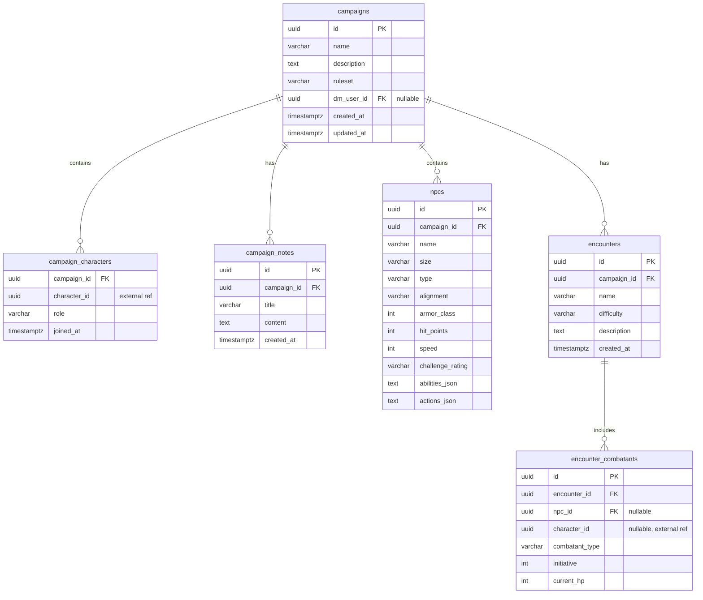

# Campaign, NPC & Encounter Domain — Living Specification

> This is the authoritative source of truth for the Phase 2/3 `campaign-service` domain, database schema, and API routing contracts.
> Update this file only after merging a completed change from `openspec/changes/`.

---

## Context & Objectives

`campaign-service` enables Dungeon Masters (DMs) to create and manage D&D campaigns, associate player characters with campaigns under strict ruleset enforcement, build NPC stat blocks, and run combat encounters with initiative tracking (Phases 2 and 3 of the Dungeoneer roadmap).

---

## Functional Requirements

- **[RF-01] Campaign CRUD & Ruleset Enforcement (`UC6`)**: DMs can create, update, and delete campaigns (`campaigns` table). Each campaign declares a `ruleset` (`SRD_2014` or `SRD_2024`). Only player characters matching the campaign's ruleset can join (`RulesetMismatchException` → `409 Conflict` if mismatched).
- **[RF-02] Cross-Service Character Association**: `campaign-service` owns the `campaign_characters` relationship table, storing external `character_id` references and hydrating full character details via REST calls through `api-gateway` (`:9090`) to `player-character-service`.
- **[RF-03] NPC Stat Block Builder (`UC7`)**: DMs can create and manage NPCs (`npcs`) within a campaign, reusing `AbilityScores` and `DiceRoll` domain mechanics for attacks, saving throws, and challenge ratings.
- **[RF-04] Encounter Builder & Initiative Tracker (Phase 3)**: DMs can build combat encounters (`encounters`, `encounter_combatants`) with CR difficulty estimation and track turn-by-turn initiative and HP across both PCs (`character_id`) and NPCs (`npc_id`).
- **[RF-05] API Gateway Routing**:
  - `/api/campaigns/**` → `campaign-service:8081`
  - `/api/npcs/**` → `campaign-service:8081`

---

## Non-Functional Requirements

- **[RNF-01] Schema Isolation**: `campaign-service` persists exclusively to the `campaign` PostgreSQL schema and **NEVER** performs SQL joins or cross-queries against the `player_character` schema.
- **[RNF-02] Clean Architecture**: Must follow the same Hexagonal package structure as `player-character-service`, with zero framework imports in `domain/model/`.

---

## Entity-Relationship Diagram (`campaign` Schema)

---

## Out of Scope

- Real-time WebSocket synchronization during combat encounters (deferred to Phase 3+).
- Player character internal state management (governed by `openspec/specs/player-character-domain.md`).

---

## Revision History

| Version | Date | Author | Summary |
|---------|------|--------|---------|
| 1.0.0 | 2026-10-29 | @jaca | Migrated from `docs/spec/SPEC.md`, `docs/USE-CASES.md`, `docs/spec/res/er-diagram.md`, and `docs/spec/res/api-contracts.md` |
