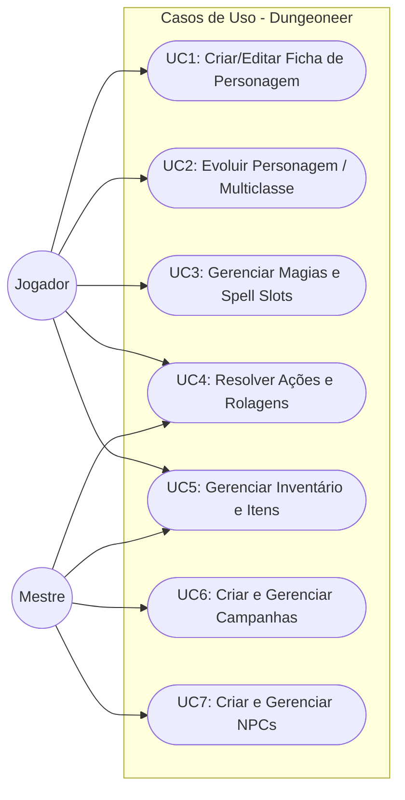
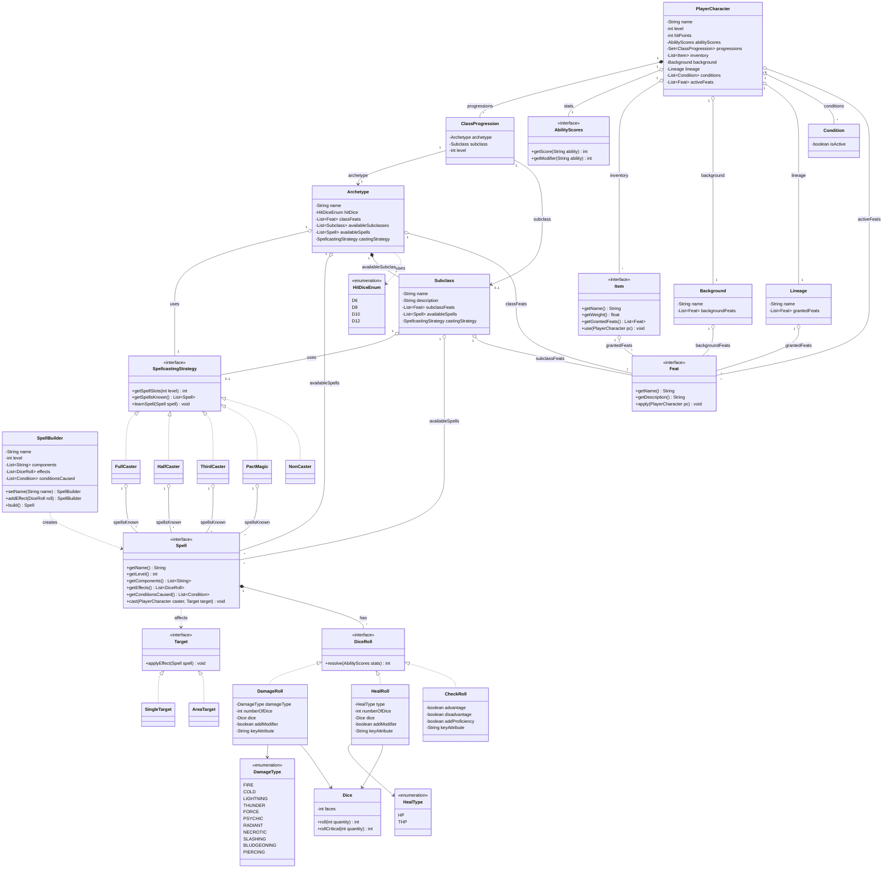

# Player Character Domain & API — Living Specification

> This is the authoritative source of truth for the `player-character-service` domain model, object-oriented design patterns, use cases, SRD seed data scope, and REST API contracts.
> Update this file only after merging a completed change from `openspec/changes/`.

---

## Context & Objectives

The `player-character-service` encapsulates all D&D 5e (2014) and 2024 Revised rules governing player characters, ability scores, class progressions, spellcasting, feats, inventory, and dice resolution. Its core domain layer is pure Java 21 with zero framework dependencies, leveraging GoF and SOLID design patterns to handle complex RPG mechanics cleanly.

### Core Object-Oriented Design Decisions

1. **Composition over Inheritance (`Feat` Strategy)**: Rather than building a rigid class hierarchy for character capabilities, feats and traits are modeled via the `Feat` Strategy interface (`apply(PlayerCharacter pc)`). This enables dynamic injection of capabilities from lineages, classes, backgrounds, and magic items without subclass explosion.
2. **Builder Pattern for Complex Entities (`SpellBuilder`)**: `Spell` entities have many optional attributes (multiple damage dice, conditions, components). `SpellBuilder` standardizes instantiation without telescoping constructors.
3. **Interface Segregation Principle (`SpellcastingStrategy`)**: Spellcasting mechanics are extracted into `SpellcastingStrategy` with dedicated implementations (`FullCaster`, `HalfCaster`, `ThirdCaster`, `PactMagic`, `NonCaster`), keeping martial classes free of unused spellcasting state.
4. **Dependency Inversion Principle (`Target`)**: Spells act upon the `Target` abstraction (`SingleTarget`, `AreaTarget`) rather than concrete map/grid implementations.
5. **Single Responsibility & Value Objects (`Dice`)**: Physical dice are modeled as an immutable `Dice` Value Object (`roll(int quantity)`, `rollCritical(int quantity)`) isolating critical hit and random roll rules.
6. **DRY via `AbilityScores` Abstraction**: Ability scores (`Strength`, `Dexterity`, `Constitution`, `Intelligence`, `Wisdom`, `Charisma`) and modifier calculations (`floor((score - 10) / 2)`) are centralized in `AbilityScores` and composed across PCs and NPCs.
7. **Open/Closed Principle on `Item` Feat Injection**: Equipment and magic items can grant `List<Feat>` to a `PlayerCharacter` when equipped/attuned, extending character capabilities without modifying `PlayerCharacter`.
8. **Cohesive Roll Hierarchy (`DiceRoll` Strategy)**: Mechanical resolutions implement `DiceRoll` (`resolve(AbilityScores stats)`) through specialized classes: `DamageRoll`, `HealRoll`, and `CheckRoll` (unifying attack rolls, ability checks, and saving throws with advantage/disadvantage and proficiency).

---

## Functional Requirements

### Domain Use Cases



- **[RF-01] Create & Manage Character (`UC1`)**: Define base `AbilityScores` (via `STANDARD_ARRAY`, `POINT_BUY` 27-point budget, or server-validated `ROLLED` 4d6-drop-lowest), select `Lineage` and `Background` (injecting corresponding `Feat`s via `RulesEngine`), and initialize the first `ClassProgression`.
  - *Implementation Status*: `PlayerCharacter`, `AbilityScores`, `Ruleset`, `AbilityScoreMethod`, `CreateCharacterUseCase`, outbound repository ports/JPA adapters, and `GlobalExceptionHandler` are implemented; `PlayerCharacterController` (`POST /api/characters`) has failing MockMvc tests written (TDD RED phase) ready for GREEN phase implementation.
- **[RF-02] Level Up & Multiclass (`UC2`)**: Increment levels on an existing `ClassProgression` or add a new `ClassProgression` (validating multiclass ability score prerequisites), select a `Subclass` at the archetype's subclass threshold level, and recalculate proficiency bonus, HP, and `SpellcastingStrategy` slots.
- **[RF-03] Spell Management & Search (`UC3`)**: Query available spells filtered by class, level, school, and name; learn/prepare spells on a character; and track daily spell slot consumption and recovery.
- **[RF-04] Action & Dice Roll Resolution (`UC4`)**: Instantiate and resolve `CheckRoll` (attacks, skill checks, saving throws with advantage/disadvantage/proficiency), `DamageRoll`, and `HealRoll` based on the actor's `AbilityScores`.
- **[RF-05] Inventory & Item Management (`UC5`)**: Add/remove items, track carrying weight, enforce the 3-slot attunement limit, and dynamically apply/remove item-granted `Feat`s.
- **[RF-06] SRD Reference Data Seeding**: Pre-populate SRD reference data via Flyway migrations tagged with `source = 'SRD'` and `ruleset = 'SRD_2014'` or `'SRD_2024'`:

| Category | Count | Source Scope |
|----------|-------|--------------|
| Classes (`archetypes`) | 13 | All SRD base classes |
| Subclasses (`subclasses`) | 13 (1 per class) | SRD only (e.g., Champion, Life Domain) |
| Lineages (`lineages`) | 9 | Human, Elf, Dwarf, Halfling, Gnome, Half-Elf, Half-Orc, Tiefling, Dragonborn |
| Backgrounds (`backgrounds`) | 6 | Acolyte, Criminal, Folk Hero, Noble, Sage, Soldier |
| Spells (`spells`) | ~300 | SRD 5.1 / 5.2 spell list |
| Feats (`feats`) | ~40 | SRD feats |

- **[RF-07] Homebrew Content Extensions**: Allow DMs/users to create custom classes, spells, and feats tagged with `source = 'HOMEBREW'` and scoped by `owner_id`.

---

## Core Domain Class Diagram



---

## REST API Contracts (`player-character-service`)

### Character Management Endpoints

| Method | Path | Description |
|--------|------|-------------|
| `POST` | `/api/characters` | Create a new character |
| `GET` | `/api/characters` | List all characters |
| `GET` | `/api/characters/{id}` | Get character by ID |
| `PUT` | `/api/characters/{id}` | Update character |
| `DELETE` | `/api/characters/{id}` | Delete character |
| `POST` | `/api/characters/{id}/level-up` | Level up a character |
| `POST` | `/api/characters/{id}/multiclass` | Add a new class to a character |

### Spell Search Endpoints

| Method | Path | Description |
|--------|------|-------------|
| `GET` | `/api/spells` | List/search spells (query params: `class`, `level`, `school`, `name`) |
| `GET` | `/api/spells/{id}` | Get spell details |

### Reference Data Endpoints

| Method | Path | Description |
|--------|------|-------------|
| `GET` | `/api/reference/classes` | List all available classes |
| `GET` | `/api/reference/lineages` | List all available lineages |
| `GET` | `/api/reference/backgrounds` | List all available backgrounds |
| `GET` | `/api/reference/feats` | List all available feats |

### Homebrew Content Endpoints

| Method | Path | Description |
|--------|------|-------------|
| `POST` | `/api/reference/homebrew/spells` | Create homebrew spell |
| `POST` | `/api/reference/homebrew/feats` | Create homebrew feat |
| `POST` | `/api/reference/homebrew/classes` | Create homebrew class |

---

## Non-Functional Requirements

- **[RNF-01] Inbound DTO Validation**: All incoming request DTOs in `application/dto/` must validate fields using Jakarta Validation annotations (`@NotNull`, `@NotBlank`, `@Min`, `@Max`, `@Valid`).
- **[RNF-02] RFC 7807 `ProblemDetail` Error Mapping**: All domain exceptions must map to deterministic HTTP status codes via `@ControllerAdvice`:

| Domain Exception | HTTP Status | Example |
|-----------------|-------------|---------|
| `CharacterNotFoundException` | `404 Not Found` | Character ID doesn't exist |
| `InvalidAbilityScoreException` | `422 Unprocessable Entity` | Point Buy exceeds 27 points |
| `MulticlassPrerequisiteException` | `422 Unprocessable Entity` | Doesn't meet ability score minimum |
| `SpellSlotExhaustedException` | `409 Conflict` | No spell slots remaining |
| `RulesetMismatchException` | `409 Conflict` | 2014 character trying to join 2024 campaign |

Example `ProblemDetail` payload:
```json
{
  "type": "https://dungeoneer.app/errors/invalid-ability-score",
  "title": "Invalid Ability Score",
  "status": 422,
  "detail": "Point Buy total exceeds the 27-point budget. Current total: 31.",
  "instance": "/api/characters",
  "timestamp": "2026-08-22T03:00:00Z"
}
```

- **[RNF-03] OpenAPI 3.0 & Client Generation**: Endpoints are documented via `springdoc-openapi-starter-webmvc-ui` (`/swagger-ui.html`), with TypeScript clients generated into `dungeoneer-frontend/lib/api/generated/`.

---

## Out of Scope

- Campaign, NPC, and combat encounter management (governed by `openspec/specs/campaign-domain.md`).
- Database column definitions and Flyway SQL schemas (governed by `openspec/specs/player-character-data-model.md`).

---

## Revision History

| Version | Date | Author | Summary |
|---------|------|--------|---------|
| 1.0.0 | 2026-10-29 | @jaca | Migrated from `README.md`, `docs/USE-CASES.md`, `docs/spec/SPEC.md`, `docs/STATE.md`, and `docs/spec/res/api-contracts.md` |
