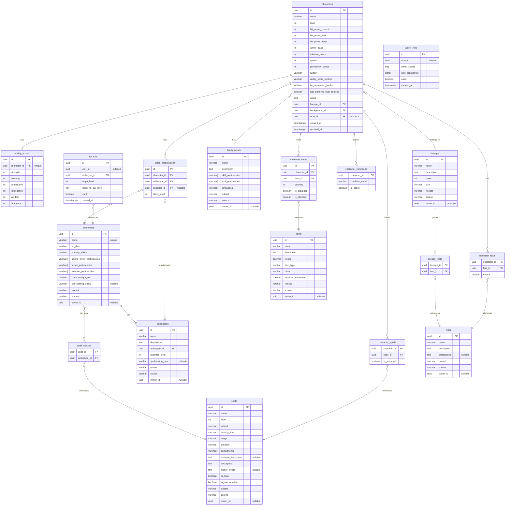

# Player Character Data Model & Persistence — Living Specification

> This is the authoritative source of truth for the PostgreSQL `player_character` schema, Entity-Relationship model, table constraints, and Flyway migration conventions.
> Update this file only after merging a completed change from `openspec/changes/`.

---

## Context & Objectives

The `player-character-service` persists all character state and SRD/Homebrew reference data in the isolated `player_character` schema on PostgreSQL 15. Schema evolution is managed exclusively through numbered SQL Flyway migrations (`V1__...sql`, `V2__...sql`).

---

## Functional Requirements

- **[RF-01] Core Character Tables**: Persist character sheets (`characters`), 1-to-1 ability scores (`ability_scores`), multiclass progressions (`class_progressions`), known/prepared spells (`character_spells`), inventory (`character_items`), granted feats (`character_feats`), and active conditions (`character_conditions`).
- **[RF-02] Reference & Homebrew Data Tables**: Persist classes (`archetypes`), specializations (`subclasses`), spells (`spells`, `spell_classes`), feats (`feats`), lineages (`lineages`, `lineage_feats`), backgrounds (`backgrounds`), and equipment (`items`) with `ruleset` (`SRD_2014`, `SRD_2024`) and `source` (`SRD`, `HOMEBREW`) discriminators.

---

## Non-Functional Requirements

- **[RNF-01] Primary Keys & Timestamps**: All entity primary keys use `UUID` (`DEFAULT gen_random_uuid()`), and audit timestamps use `TIMESTAMPTZ` (UTC).
- **[RNF-02] Database Integrity Constraints**: Domain invariants (level ranges `1-20`, ability score ranges `1-30`, spell levels `0-9`, valid `ruleset` values, and unique `character_id + archetype_id` progressions) must be enforced at the database level via `CHECK`, `UNIQUE`, and `FOREIGN KEY` constraints.

---

## Entity-Relationship Diagram (`player_character` Schema)

---

## Table Specifications

### Core Tables

#### `characters`

| Column | Type | Constraints | Notes |
|--------|------|-------------|-------|
| `id` | `UUID` | PK, DEFAULT gen_random_uuid() | |
| `name` | `VARCHAR(100)` | NOT NULL | |
| `level` | `INT` | NOT NULL, DEFAULT 1, CHECK (1-20) | Total character level |
| `hit_points_current` | `INT` | NOT NULL | |
| `hit_points_max` | `INT` | NOT NULL | |
| `hit_points_temp` | `INT` | NOT NULL, DEFAULT 0 | |
| `armor_class` | `INT` | NOT NULL, DEFAULT 10 | |
| `initiative_bonus` | `INT` | NOT NULL, DEFAULT 0 | |
| `speed` | `INT` | NOT NULL, DEFAULT 30 | In feet |
| `proficiency_bonus` | `INT` | NOT NULL, DEFAULT 2 | |
| `ruleset` | `VARCHAR(10)` | NOT NULL, CHECK IN ('SRD_2014', 'SRD_2024') | |
| `ability_score_method` | `VARCHAR(20)` | NOT NULL | STANDARD_ARRAY, POINT_BUY, ROLLED |
| `hp_calculation_method` | `VARCHAR(15)` | NOT NULL, DEFAULT 'MAX' | MAX, AVERAGE, ROLLED |
| `has_pending_level_choices` | `BOOLEAN` | NOT NULL, DEFAULT FALSE | Flag set when created at level > 1, deferred until interactive level-up wizards |
| `notes` | `TEXT` | NOT NULL, DEFAULT '' | Player notes and campaign annotations |
| `lineage_id` | `UUID` | FK → lineages.id, NOT NULL | |
| `background_id` | `UUID` | FK → backgrounds.id, NOT NULL | |
| `user_id` | `UUID` | NOT NULL | Logical reference to auth-service users.id (enforced for tenant isolation) |
| `created_at` | `TIMESTAMPTZ` | NOT NULL, DEFAULT NOW() | |
| `updated_at` | `TIMESTAMPTZ` | NOT NULL, DEFAULT NOW() | |

**Indexes**:
- `CREATE INDEX IF NOT EXISTS idx_characters_user_id ON player_character.characters(user_id);`

#### `ability_scores`

| Column | Type | Constraints |
|--------|------|-------------|
| `id` | `UUID` | PK |
| `character_id` | `UUID` | FK → characters.id, UNIQUE, NOT NULL |
| `strength` | `INT` | NOT NULL, CHECK (1-30) |
| `dexterity` | `INT` | NOT NULL, CHECK (1-30) |
| `constitution` | `INT` | NOT NULL, CHECK (1-30) |
| `intelligence` | `INT` | NOT NULL, CHECK (1-30) |
| `wisdom` | `INT` | NOT NULL, CHECK (1-30) |
| `charisma` | `INT` | NOT NULL, CHECK (1-30) |

#### `class_progressions`

| Column | Type | Constraints |
|--------|------|-------------|
| `id` | `UUID` | PK |
| `character_id` | `UUID` | FK → characters.id, NOT NULL |
| `archetype_id` | `UUID` | FK → archetypes.id, NOT NULL |
| `subclass_id` | `UUID` | FK → subclasses.id, NULLABLE |
| `class_level` | `INT` | NOT NULL, CHECK (1-20) |
| `created_at` | `TIMESTAMPTZ` | NOT NULL, DEFAULT NOW() |
| `updated_at` | `TIMESTAMPTZ` | NOT NULL, DEFAULT NOW() |
| UNIQUE | | (`character_id`, `archetype_id`) |

**Indexes**:
- `CREATE INDEX IF NOT EXISTS idx_class_progressions_character_id ON player_character.class_progressions(character_id);`

#### `ability_rolls`

| Column | Type | Constraints | Description |
|--------|------|-------------|-------------|
| `id` | `UUID` | PK, DEFAULT gen_random_uuid() | |
| `user_id` | `UUID` | NOT NULL | Authenticated user ID |
| `rolled_scores` | `INT[]` | NOT NULL | 6 rolled ability scores (4d6 drop lowest) |
| `dice_breakdown` | `JSONB` | NOT NULL, DEFAULT '[]' | Detailed 4d6 roll history and dropped dice per score |
| `used` | `BOOLEAN` | NOT NULL, DEFAULT FALSE | Whether roll token has been consumed by character creation |
| `created_at` | `TIMESTAMPTZ` | NOT NULL, DEFAULT NOW() | Audit timestamp |

**Indexes**:
- `CREATE UNIQUE INDEX IF NOT EXISTS idx_unused_ability_roll ON player_character.ability_rolls(user_id) WHERE used = FALSE;` (Single-chance guarantee preventing reroll farming)

#### `hp_rolls`

| Column | Type | Constraints | Description |
|--------|------|-------------|-------------|
| `id` | `UUID` | PK, DEFAULT gen_random_uuid() | |
| `user_id` | `UUID` | NOT NULL | Authenticated user ID |
| `archetype_id` | `UUID` | FK → archetypes.id, NOT NULL | Class archetype associated with the Hit Die |
| `target_level` | `INT` | NOT NULL, CHECK (target_level >= 2 AND target_level <= 20) | Character level rolled for |
| `rolled_hp_per_level` | `INT[]` | NOT NULL | Array of rolled hit point increases (levels 2..N) |
| `used` | `BOOLEAN` | NOT NULL, DEFAULT FALSE | Whether roll token has been consumed |
| `created_at` | `TIMESTAMPTZ` | NOT NULL, DEFAULT NOW() | Audit timestamp |

**Indexes**:
- `CREATE UNIQUE INDEX IF NOT EXISTS idx_unused_hp_roll ON player_character.hp_rolls(user_id, archetype_id, target_level) WHERE used = FALSE;` (Single-chance guarantee per user, class, and target level)

#### `character_spells`

| Column | Type | Constraints |
|--------|------|-------------|
| `character_id` | `UUID` | FK → characters.id |
| `spell_id` | `UUID` | FK → spells.id |
| `is_prepared` | `BOOLEAN` | NOT NULL, DEFAULT false |
| PK | | (`character_id`, `spell_id`) |

#### `character_items`

| Column | Type | Constraints |
|--------|------|-------------|
| `id` | `UUID` | PK |
| `character_id` | `UUID` | FK → characters.id, NOT NULL |
| `item_id` | `UUID` | FK → items.id, NOT NULL |
| `quantity` | `INT` | NOT NULL, DEFAULT 1 |
| `is_equipped` | `BOOLEAN` | NOT NULL, DEFAULT false |
| `is_attuned` | `BOOLEAN` | NOT NULL, DEFAULT false |

#### `character_feats`

| Column | Type | Constraints |
|--------|------|-------------|
| `character_id` | `UUID` | FK → characters.id |
| `feat_id` | `UUID` | FK → feats.id |
| `source` | `VARCHAR(20)` | NOT NULL (CLASS, LINEAGE, BACKGROUND, ITEM, LEVEL_UP) |
| PK | | (`character_id`, `feat_id`) |

#### `character_conditions`

| Column | Type | Constraints |
|--------|------|-------------|
| `character_id` | `UUID` | FK → characters.id |
| `condition_name` | `VARCHAR(50)` | NOT NULL |
| `is_active` | `BOOLEAN` | NOT NULL, DEFAULT true |
| PK | | (`character_id`, `condition_name`) |

---

### Reference Data Tables

#### `archetypes` (Classes)

| Column | Type | Constraints |
|--------|------|-------------|
| `id` | `UUID` | PK |
| `name` | `VARCHAR(50)` | NOT NULL |
| `hit_dice` | `VARCHAR(3)` | NOT NULL (D6, D8, D10, D12) |
| `primary_ability` | `VARCHAR(15)` | NOT NULL |
| `saving_throw_proficiencies` | `VARCHAR[]` | NOT NULL |
| `armor_proficiencies` | `VARCHAR[]` | |
| `weapon_proficiencies` | `VARCHAR[]` | |
| `spellcasting_type` | `VARCHAR(15)` | FULL, HALF, THIRD, PACT, NONE |
| `spellcasting_ability` | `VARCHAR(15)` | NULLABLE |
| `ruleset` | `VARCHAR(10)` | NOT NULL |
| `source` | `VARCHAR(10)` | NOT NULL, DEFAULT 'SRD' |
| `owner_id` | `UUID` | NULLABLE (for homebrew) |
| UNIQUE | | (`name`, `ruleset`, `source`) |

#### `subclasses`

| Column | Type | Constraints |
|--------|------|-------------|
| `id` | `UUID` | PK |
| `name` | `VARCHAR(100)` | NOT NULL |
| `description` | `TEXT` | |
| `archetype_id` | `UUID` | FK → archetypes.id, NOT NULL |
| `subclass_level` | `INT` | NOT NULL (level when subclass is chosen) |
| `spellcasting_type` | `VARCHAR(15)` | NULLABLE (overrides archetype if set) |
| `ruleset` | `VARCHAR(10)` | NOT NULL |
| `source` | `VARCHAR(10)` | NOT NULL, DEFAULT 'SRD' |
| `owner_id` | `UUID` | NULLABLE |

#### `spells`

| Column | Type | Constraints |
|--------|------|-------------|
| `id` | `UUID` | PK |
| `name` | `VARCHAR(100)` | NOT NULL |
| `level` | `INT` | NOT NULL, CHECK (0-9) |
| `school` | `VARCHAR(20)` | NOT NULL |
| `casting_time` | `VARCHAR(50)` | NOT NULL |
| `range` | `VARCHAR(50)` | NOT NULL |
| `duration` | `VARCHAR(50)` | NOT NULL |
| `components` | `VARCHAR[]` | NOT NULL (V, S, M) |
| `material_description` | `TEXT` | NULLABLE |
| `description` | `TEXT` | NOT NULL |
| `higher_levels` | `TEXT` | NULLABLE |
| `is_ritual` | `BOOLEAN` | NOT NULL, DEFAULT false |
| `is_concentration` | `BOOLEAN` | NOT NULL, DEFAULT false |
| `ruleset` | `VARCHAR(10)` | NOT NULL |
| `source` | `VARCHAR(10)` | NOT NULL, DEFAULT 'SRD' |
| `owner_id` | `UUID` | NULLABLE |

#### `spell_classes`

| Column | Type | Constraints |
|--------|------|-------------|
| `spell_id` | `UUID` | FK → spells.id |
| `archetype_id` | `UUID` | FK → archetypes.id |
| PK | | (`spell_id`, `archetype_id`) |

#### `feats`

| Column | Type | Constraints |
|--------|------|-------------|
| `id` | `UUID` | PK |
| `name` | `VARCHAR(100)` | NOT NULL |
| `description` | `TEXT` | NOT NULL |
| `prerequisite` | `TEXT` | NULLABLE |
| `ruleset` | `VARCHAR(10)` | NOT NULL |
| `source` | `VARCHAR(10)` | NOT NULL, DEFAULT 'SRD' |
| `owner_id` | `UUID` | NULLABLE |

#### `lineages`

| Column | Type | Constraints |
|--------|------|-------------|
| `id` | `UUID` | PK |
| `name` | `VARCHAR(50)` | NOT NULL |
| `description` | `TEXT` | |
| `speed` | `INT` | NOT NULL, DEFAULT 30 |
| `size` | `VARCHAR(10)` | NOT NULL |
| `ability_bonuses` | `JSONB` | NOT NULL, DEFAULT '{}' (SRD_2014 fixed ASI; empty in SRD_2024) |
| `traits_summary` | `TEXT[]` | NULLABLE (racial/lineage traits) |
| `ruleset` | `VARCHAR(10)` | NOT NULL |
| `source` | `VARCHAR(10)` | NOT NULL, DEFAULT 'SRD' |
| `owner_id` | `UUID` | NULLABLE |
| UNIQUE | | (`name`, `ruleset`, `source`) |

#### `lineage_feats`

| Column | Type | Constraints |
|--------|------|-------------|
| `lineage_id` | `UUID` | FK → lineages.id |
| `feat_id` | `UUID` | FK → feats.id |
| PK | | (`lineage_id`, `feat_id`) |

#### `backgrounds`

| Column | Type | Constraints |
|--------|------|-------------|
| `id` | `UUID` | PK |
| `name` | `VARCHAR(50)` | NOT NULL |
| `description` | `TEXT` | |
| `skill_proficiencies` | `VARCHAR[]` | NOT NULL |
| `tool_proficiencies` | `VARCHAR[]` | |
| `languages` | `VARCHAR[]` | |
| `allowed_ability_bonuses` | `VARCHAR[]` | NOT NULL, DEFAULT '{}' (SRD_2024 3 allowed ASI abilities) |
| `origin_feat_name` | `VARCHAR(100)` | NULLABLE (SRD_2024 Origin Feat name) |
| `origin_feat_description` | `TEXT` | NULLABLE (SRD_2024 Origin Feat description) |
| `ruleset` | `VARCHAR(10)` | NOT NULL |
| `source` | `VARCHAR(10)` | NOT NULL, DEFAULT 'SRD' |
| `owner_id` | `UUID` | NULLABLE |
| UNIQUE | | (`name`, `ruleset`, `source`) |

#### `items`

| Column | Type | Constraints |
|--------|------|-------------|
| `id` | `UUID` | PK |
| `name` | `VARCHAR(100)` | NOT NULL |
| `description` | `TEXT` | |
| `weight` | `DECIMAL(6,2)` | NOT NULL, DEFAULT 0 |
| `item_type` | `VARCHAR(20)` | NOT NULL (WEAPON, ARMOR, POTION, WONDROUS, etc.) |
| `rarity` | `VARCHAR(15)` | COMMON, UNCOMMON, RARE, VERY_RARE, LEGENDARY |
| `requires_attunement` | `BOOLEAN` | NOT NULL, DEFAULT false |
| `ruleset` | `VARCHAR(10)` | NOT NULL |
| `source` | `VARCHAR(10)` | NOT NULL, DEFAULT 'SRD' |
| `owner_id` | `UUID` | NULLABLE |

---

## Flyway Migration History

| Version | Script | Description |
|---------|--------|-------------|
| V1 | `V1__init_player_character_schema.sql` | Initial core character and reference data tables |
| V2 | `V2__seed_srd_2014_reference_data.sql` | Seed SRD 2014 reference data (classes, lineages, backgrounds, spells, feats) |
| V3 | `V3__align_reference_data_schema_and_seed_2024.sql` | Align reference data schemas, add unique constraints, JSONB ASI, and seed SRD 2024 |
| V4 | `V4__add_character_crud_and_roll_tables.sql` | Add character CRUD fields, class progressions, ability rolls, and hp rolls with single-chance indexes |

---

## Out of Scope

- `campaign` database schema (governed by `openspec/specs/campaign-domain.md`).

---

## Revision History

| Version | Date | Author | Summary |
|---------|------|--------|---------|
| 1.2.0 | 2026-10-30 | @jaca | Added character CRUD metadata, notes, single-chance ability_rolls and hp_rolls, and class_progressions (character-crud-backend) |
| 1.1.0 | 2026-10-30 | @jaca | Aligned schema to player_character, added V2/V3 reference tables with dual ruleset unique constraints, ASI JSONB/arrays, and origin feat metadata (reference-data-backend) |
| 1.0.0 | 2026-10-29 | @jaca | Migrated from `docs/spec/res/data-models.md` and `docs/spec/res/er-diagram.md` |
