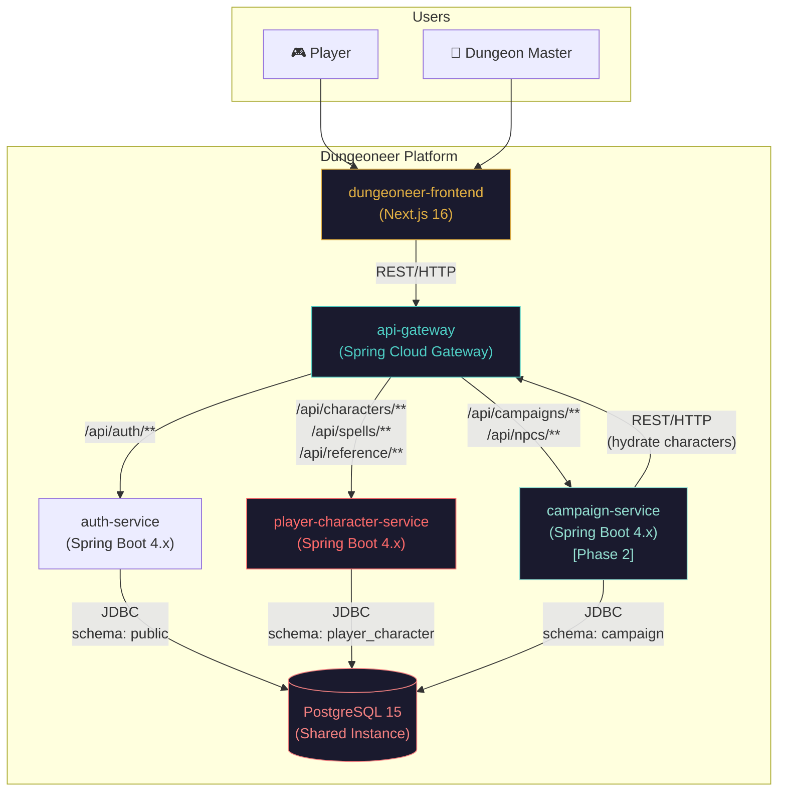
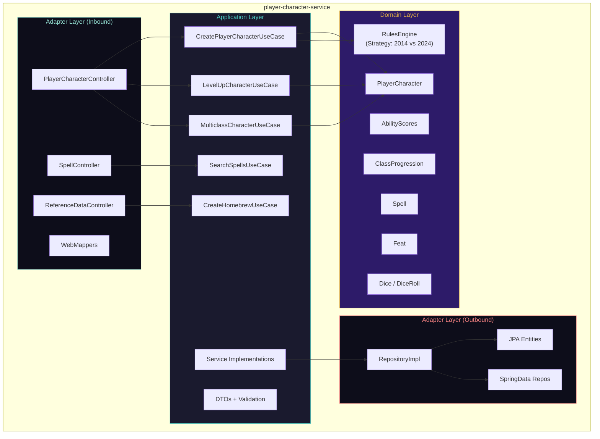
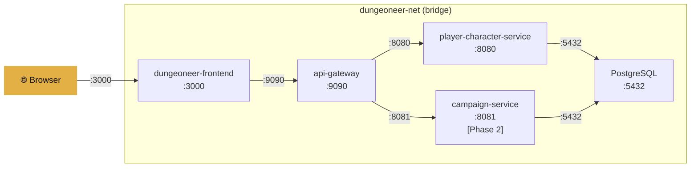

# Dungeoneer System Architecture — Living Specification

> This is the authoritative source of truth for Dungeoneer's platform vision, system topology, Clean Architecture rules, Dual Ruleset strategy, and cross-cutting constraints.
> Update this file only after merging a completed change from `openspec/changes/`.

---

## Context & Objectives

### Problem Statement
Dungeon Masters and Players of Dungeons & Dragons need a unified, modern tool to manage character sheets, campaigns, NPCs, and game mechanics. Existing tools are either too simplistic (paper sheets), locked behind paywalls (D&D Beyond), or lack proper engineering (homebrew spreadsheets).

### Product Vision
**Dungeoneer** is a web-based D&D companion that delivers a premium, dark-fantasy-themed experience for managing characters, campaigns, and game sessions. It supports both D&D 5e (2014) and D&D 2024 Revised rulesets, ships with pre-seeded SRD content, and allows homebrew extensions.

### Target Actors

| Actor | Description |
|-------|-------------|
| **Player** | Creates and manages character sheets, tracks HP/spells/inventory during sessions |
| **Dungeon Master (DM)** | Creates campaigns, builds NPCs, designs encounters, manages sessions |

### Phased Roadmap

- **Phase 1 — MVP: Character Sheet Manager**: Character CRUD (multi-step wizard), Character Sheet Dashboard (card-based), Level Up / Multiclass, Ability Score Generation (Standard Array, Point Buy 27-point, server-validated 4d6-drop-lowest), Spell Search & Filter, Interactive Dice Rolling, Inventory Management, SRD Data Seeding via Flyway, and Homebrew Content creation.
- **Phase 2 — Campaign & NPC Management**: Campaign CRUD with ruleset enforcement, NPC Stat Block Builder reusing `AbilityScores`/`DiceRoll` domain logic, and Campaign-Character Association.
- **Phase 3 — Session Tools**: Encounter Builder (with CR calculation and difficulty estimation) and Initiative Tracker.

---

## Functional Requirements

- **[RF-01] Dual Ruleset Support (`SRD_2014` & `SRD_2024`)**: The platform must support both D&D 5e 2014 (SRD 5.1, CC-BY-4.0) and D&D 2024 Revised (SRD 5.2) at per-character granularity. Reference data is tagged with a `ruleset` discriminator (`SRD_2014` | `SRD_2024` | `HOMEBREW`), and a `RulesEngine` abstraction (Strategy Pattern) resolves mechanical differences:

| Mechanic | 5e 2014 (`SRD_2014`) | 2024 Revised (`SRD_2024`) |
|----------|----------------------|---------------------------|
| **Race/Lineage** | Race grants fixed ASI | Lineage is cosmetic; Background grants ASI |
| **Background** | Grants skills + tool proficiencies | Grants ASI + Origin Feat + skills |
| **Feats** | Optional rule, replaces ASI at level-up | Integrated into backgrounds and class features |
| **Spellcasting** | Prepared vs Known per class | Unified "Prepared Spells" system |
| **Multiclass Prereqs** | Ability score minimums | Same, with updated thresholds |

- **[RF-02] Microservices Container Topology**: The platform comprises independent containers communicating over REST/HTTP through an API Gateway:

| Container | Technology | Responsibility |
|-----------|-----------|----------------|
| `dungeoneer-frontend` | Next.js 16, React 19, TailwindCSS 4, shadcn/ui | UI, client-side state, dice animations |
| `api-gateway` | Spring Cloud Gateway (Spring Boot 4.x, Java 21) | Routing, CORS, rate limiting, auth forwarding |
| `player-character-service` | Spring Boot 4.x, Java 21, Clean Architecture | Character CRUD, domain logic, spells, feats |
| `auth-service` | Spring Boot 4.x, Java 21 | User authentication and identity |
| `campaign-service` | Spring Boot 4.x, Java 21, Clean Architecture | Campaigns, NPCs, encounters (Phase 2+) |
| `db` | PostgreSQL 15 | Shared instance, schema-per-service |

- **[RF-03] API Gateway Routing**: All external client traffic enters through `api-gateway` (`:9090`), which routes requests by path prefix:
  - `/api/auth/**` → `auth-service:8082` (endpoints: `POST /api/auth/register`, `POST /api/auth/login`, `GET /api/auth/me` session verification)
  - `/api/characters/**` → `player-character-service:8080`
  - `/api/spells/**` → `player-character-service:8080`
  - `/api/reference/**` → `player-character-service:8080`
  - `/api/campaigns/**` → `campaign-service:8081`
  - `/api/npcs/**` → `campaign-service:8081`

- **[RF-04] Strict Data Ownership & Schema Isolation**:
  - `player-character-service` owns: characters, ability scores, spells, feats, items, lineages, backgrounds, archetypes, subclasses (schema: `player_character`).
  - `campaign-service` owns: campaigns, NPCs, encounters, and the campaign↔character association (schema: `campaign`).
  - Services **NEVER** cross-query another service's database schema — cross-service hydration occurs exclusively via REST calls through the API Gateway.

---

## Non-Functional Requirements

- **[RNF-01] Hexagonal / Clean Architecture Isolation**: Every Spring Boot microservice must enforce strict separation of concerns across four package layers, with **ZERO framework imports** (no Spring, no JPA, no Jakarta Validation, no Lombok) permitted inside `domain/model/`:

```text
└───dungeoneer
    │   BackendApplication.java
    │
    ├───campaign
    ├───core
    │   ├───config
    │   │       DatabaseConfig.java
    │   │       SecurityConfig.java
    │   │
    │   └───exception
    └───playerCharacter
        ├───adapter
        │   ├───in
        │   │   └───web
        │   │       ├───controller
        │   │       │       PlayerCharacterController.java
        │   │       │
        │   │       └───mapper
        │   │               PlayerCharacterWebMapper.java
        │   │
        │   └───out
        │       ├───config
        │       │       PlayerCharacterUseCaseConfig.java
        │       │
        │       └───persistence
        │           ├───adapter
        │           │       PlayerCharacterRepositoryImpl.java
        │           │
        │           ├───entity
        │           │       PlayerCharacterJpaEntity.java
        │           │
        │           └───springdata
        │                   SpringDataPlayerCharacterRepo.java
        │
        ├───application
        │   ├───dto
        │   │       CreatePlayerCharacterDTO.java
        │   │
        │   ├───port
        │   │   ├───in
        │   │   │       CreatePlayerCharacterUseCase.java
        │   │   │
        │   │   └───out
        │   │           CharacterRepositoryPort.java
        │   │
        │   └───service
        │           CreatePlayerCharacterService.java
        │
        └───domain
            └───model
                    AbilityScores.java
                    Archetype.java
                    Background.java
                    ClassProgression.java
                    Feat.java
                    Lineage.java
                    PlayerCharacter.java
                    Spell.java
                    SpellcastingStrategy.java
                    Subclass.java
```

- **[RNF-02] Security Posture**:
  - `auth-service` authenticates users with BCrypt password hashing and issues HMAC-SHA256 signed JWTs (`sub` = user UUID) using `${JWT_SECRET}`.
  - `api-gateway` validates Bearer JWTs on protected routes (`/api/characters/**`) and forwards the verified `X-User-Id` header to downstream microservices, stripping any client-supplied `X-User-Id`.
  - Protected endpoints require verified `X-User-Id` and enforce character ownership.
  - CORS is configured at the **API Gateway** level and on local dev services for direct browser access.
  - Secrets, passwords, and tokens must **NEVER** be hardcoded; always inject via environment variables.

- **[RNF-03] Language & Localization**:
  - **English**: All source code, API paths, database tables/columns, comments, and git commits.
  - **Portuguese (`pt-BR`)**: All UI labels, text, and user-facing error messages.

- **[RNF-04] Standardized Error Responses**: All REST APIs must return **RFC 7807 `ProblemDetail`** JSON responses via `@ControllerAdvice`.

---

## Architecture Diagrams

### System Context (C4 Level 1)



### Container Diagram (C4 Level 2) — `player-character-service`



### Docker Compose Network Topology



---

## Out of Scope

- **Real-time WebSocket session collaboration**: Deferred to Phase 3+.
- **Character Sheet export to PDF**: Not scoped for MVP.
- **Native mobile apps (React Native / PWA)**: Out of scope; responsive web layout covers mobile devices.

---

## Revision History

| Version | Date | Author | Summary |
|---------|------|--------|---------|
| 1.2.0 | 2026-10-31 | @jaca | Added GET /api/auth/me session verification endpoint in auth-service and gateway routing (`refactor-wizard-hp-srd-and-session`) |
| 1.1.0 | 2026-10-30 | @jaca | Integrated auth-service JWT architecture, routing, and security posture from auth-jwt-backend |
| 1.0.0 | 2026-10-29 | @jaca | Migrated from `docs/spec/SPEC.md`, `docs/spec/res/architecture-diagram.md`, and `docs/ARCHITECTURE.md` into OpenSpec format |
